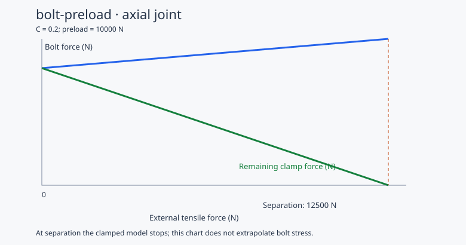

# 螺栓预紧连接分析工具

`bolt-preload` 是一个 MoonBit 库和本地命令行工具。输入连接刚度、已知预紧力和轴向外载，计算螺栓拉力、剩余夹紧力、分离载荷和名义应力。它也能将外载记录转换为应力 CSV，供独立的疲劳工具使用。

## 运行

需要 MoonBit 工具链；native 后端需要本机 C 编译环境。本项目实际验证于 moon `0.1.20260920 (914d7da)`、moonc `v0.10.14+7d59c7ec9`，运行依赖锁定为 `moonbitlang/async@0.22.4`。计算核心同时支持 native 和 JS，文件 CLI 使用 native。

在项目目录运行：

```sh
moon update
moon run --target native cmd/main -- analyze samples/joint.json --force 5000 --json _build/static.json --svg _build/joint.svg
moon run --target native cmd/main -- history samples/joint.json samples/loads.csv --stress _build/stress.csv --json _build/history.json
```

单工况示例得到 **11000 N 螺栓力、6000 N 夹紧力、220 MPa 应力**。分离外载为 12500 N。[保存的结果](samples/static.json)由同一 CLI 生成。



## 输入与计算

连接配置 JSON 的四个字段均为有限正数：

| 字段 | 含义 | 单位 |
|---|---|---|
| `bolt_stiffness_n_per_mm` | 螺栓轴向刚度 kb | N/mm |
| `joint_stiffness_n_per_mm` | 被连接件轴向刚度 kj | N/mm |
| `preload_n` | 已知安装预紧力 Fi | N |
| `stress_area_mm2` | 螺栓有效拉应力面积 As | mm² |

外载 F 是非负轴向拉力。采用分离前的线弹性模型：

```text
C = kb / (kb + kj)
Fb = Fi + C * F
Fc = Fi - kj / (kb + kj) * F
Fsep = Fi / (kj / (kb + kj))
stress = Fb / As
```

`Fb - Fc = F`，应力单位 N/mm² 即 MPa。刚度由使用者依据实际几何与材料提供。模型与公式依据参见 [NASA Fastener Design Manual](https://ntrs.nasa.gov/citations/19900009424)；该实现限定轴向线弹性载荷分配，未实现完整紧固件标准校核、剪切、弯曲、多螺栓分配、塑性、松弛或温度效应。

默认读取名为 `time_s`、`force_n` 的载荷列：

```csv
time_s,force_n
0,0
1,5000
2,0
```

时间必须有限且严格递增，力有限且非负。接受 UTF-8 BOM、CRLF 和空行。导出的应力 CSV 使用 `time_s,stress_mpa`。

采集软件导出多列文件时，可直接选择列名、分隔符和输入单位。例如 [instrument-loads.csv](samples/instrument-loads.csv) 是含备注、kN 载荷和 ms 时间的合成采集示例：

```sh
moon run --target native cmd/main -- history samples/joint.json samples/instrument-loads.csv --time-column Clock --force-column Load --time-unit ms --force-unit kN --delimiter semicolon --stress _build/imported-stress.csv
```

时间单位支持 `s`、`ms`，载荷单位支持 `N`、`kN`；分隔符为 `comma`、`semicolon`、`tab`。单位由参数显式指定，列名只用于定位数据。每条记录占一行；带分隔符的字段可加双引号，字段中的双引号写成两个双引号。其他列可为空或包含文字，但每行字段数须与表头一致；选定列的名称须唯一。数值使用小数点，换算后溢出或非零值变成零会报错。

文件开头有采集说明或使用小数逗号时，可显式选择导入方式。[logger-loads.csv](samples/logger-loads.csv) 是含两行说明、ms 时间和 kN 载荷的合成示例：

```sh
moon run --target native cmd/main -- history samples/joint.json samples/logger-loads.csv --time-column Clock --force-column Load --time-unit ms --force-unit kN --delimiter semicolon --skip-rows 2 --decimal-separator comma --stress _build/logger-stress.csv
```

`--skip-rows` 指表头之前的物理行数，包含空行，默认 0；错误信息仍保留原文件行号。`--decimal-separator` 默认 `dot`，也可指定 `comma`；小数逗号配合分号、制表符或带引号字段使用。逗号模式中的 `1,25` 表示 1.25，混用小数点和数字分组会被拒绝。说明行和数值格式均由使用者指定。

### 先确认输入，再复用标准载荷

`normalize` 不需要连接配置。它使用与 `history` 相同的导入选项，检查整份记录并换算成 s、N：

```sh
moon run --target native cmd/main -- normalize samples/logger-loads.csv --time-column Clock --force-column Load --time-unit ms --force-unit kN --delimiter semicolon --skip-rows 2 --decimal-separator comma --csv _build/normalized-loads.csv --json _build/load-summary.json
moon run --target native cmd/main -- history samples/joint.json _build/normalized-loads.csv --stress _build/normalized-stress.csv
python scripts/compare_joints.py --loads _build/normalized-loads.csv --output _build/normalized-comparison.json
```

合成示例的摘要为 3 个样本、时间 0 至 2 s、载荷 0 至 5000 N。`--csv` 导出 `time_s,force_n`，后续使用默认导入参数即可，不再重复指定原文件的列、单位和说明行。`--json` 保存 `input_samples`、`time_start_s`、`time_end_s`、`minimum_force_n`、`maximum_force_n`。两个输出都可省略，此时只检查输入并打印摘要；指定输出的父目录须已存在。

规范化保留全部样本、时间值及顺序，舍去其他列；不重采样、滤波、平移时间或校准传感器。通过只代表格式、数值和时间顺序有效，仍须由 `history` 检查具体连接的分离边界。源数据可以继续独立保存，标准 CSV 用于重复计算。输出覆盖保护和失败清除规则与分析命令一致。

达到或超过 Fsep 时，单工况返回 `SeparationReached`；历史结果保留此前有效样本及首个分离位置，不再恢复后续分析，不导出完整应力文件。历史 JSON 的 `sample_index` 从 0 开始；未分离时可选 `separation` 字段省略。

CLI 返回码：0 表示所请求计算完成，1 表示历史发生分离，2 表示输入、单工况模型或文件操作错误。输出路径不能覆盖输入或彼此重合；路径检查后会清除已存在的指定输出，避免失败后残留旧应力文件。

## 调用计算核心

在调用方 `moon.pkg` 中导入 `"gckbbrant/bolt-preload" @joint`。公开接口与类型见 [pkg.generated.mbti](pkg.generated.mbti)。

- `analyze_joint(profile, force)` 返回单工况结果或结构化错误。
- `analyze_load_history(profile, loads)` 返回有效应力前缀与可选分离事件。
- `parse_load_csv`、`loads_csv`、`stress_csv` 负责明确单位的文件交换。
- `render_svg` 生成载荷分配图。

`parse_load_csv` 的可选参数 `time_column`、`force_column`、`delimiter` 可选择测量列，`time_scale`、`force_scale` 将输入乘到 s、N；默认比例均为 1。库调用者应依据输入单位提供有限正比例。

同一 API 还可传 `skip_rows` 和 `decimal_comma`，默认分别为 0、false；这些选项与命令行使用同一解析过程。

`loads_csv(samples)` 将公开的 `LoadSample` 数组序列化成标准载荷 CSV，独立于连接模型；空数组、非有限值、负载荷或不递增时间会返回错误。

完整的独立调用示例位于 [examples/basic/main.mbt](examples/basic/main.mbt)：

```sh
moon run --target native examples/basic
moon run --target js examples/basic
```

发布前在本地消费模块，可将调用方与本项目列入同一个 `moon.work`，调用方 `moon.mod` 引入 `gckbbrant/bolt-preload@0.1.0`；工作区将其解析为本地源码。[MoonBit 本地依赖说明](https://docs.moonbitlang.com/en/latest/toolchain/moon/module.html#local-dependencies)

## 与 fatigue-spectrum 配套

两个项目各自能独立使用，通过 CSV 组合。假定 `fatigue-spectrum` 位于同级目录，在本项目运行：

```sh
python scripts/compare_joints.py --fatigue ../fatigue-spectrum
```

该脚本使用 `samples/loads.csv` 的合成载荷，分别运行两个 CLI，默认结果保存在 `_build/comparison.json`。[保存的演示结果](samples/comparison.json)采用相同计算。Python 脚本无需额外依赖。

换用自己的数据时，显式提供载荷、接头参数和 S–N 曲线，并指定两种连接件刚度：

```sh
python scripts/compare_joints.py --fatigue ../fatigue-spectrum --profile joint.json --loads loads.csv --sn material-sn.json --stiff-stiffness 800000 --soft-stiffness 300000 --bin-width 10 --output _build/my-comparison.json
```

`--profile` 中的螺栓刚度、预紧力和有效面积用于两个方案；连接件刚度由两个命令行参数分别替换，单位 N/mm，较硬方案的刚度须大于较软方案。`--loads` 默认读取 `time_s,force_n`，`--sn` 使用疲劳工具的幅值与寿命点格式。刚度和分箱宽度须有限且为正。用户提供的输入路径相对于运行命令的目录解析，`--output` 相对本项目目录解析。

多列测量文件也可通过比较脚本的 `--time-column`、`--force-column`、`--time-unit`、`--force-unit`、`--delimiter` 选项导入，含义与 `history` 命令一致。报告的 `load_format` 保留实际采用的列、单位和分隔符，`bin_width_mpa` 保留显示分箱宽度。

反复比较同一份数据时，可保存配置文件：

```sh
python scripts/compare_joints.py --config samples/comparison-config.json
python scripts/compare_joints.py --config samples/comparison-config.json --soft-stiffness 250000 --output _build/another-comparison.json
```

[配置示例](samples/comparison-config.json)只使用合成载荷与演示曲线。配置键为 `profile`、`loads`、`sn`、`fatigue`、`output`、`stiff_stiffness`、`soft_stiffness`、`bin_width`、`time_column`、`force_column`、`time_unit`、`force_unit`、`delimiter`、`skip_rows`、`decimal_separator`。配置内的路径相对于配置文件所在目录；显式命令行参数优先，命令行输入路径仍相对于调用目录，命令行输出路径仍相对于本项目目录。未设置的项采用帮助中的默认值。未知键、重复键和无效参数会报错；输出也不能覆盖配置文件。输出父目录会自动创建。

带说明行和小数逗号的完整配套示例可以直接运行：

```sh
python scripts/compare_joints.py --config samples/logger-comparison.json
```

[这份配置](samples/logger-comparison.json)连接合成采集载荷与演示曲线。每次比较开始时分别读取载荷、参数和曲线一次，两个方案共用临时快照；运行期间原文件变化不影响本次比较。报告的 `input_sha256` 保存这三个原始文件字节的 SHA-256，可与保留的输入文件比对；换行符或 BOM 改变也会影响哈希。报告中的曲线点始终来自本次使用的快照。

脚本先调用本项目的 `normalize` 检查并转换捕获的载荷，再构建疲劳工具；格式错误会在这一步停止。两种方案共用同一份标准载荷，不会再次套用原始单位或重复换算。报告的 `load_summary` 保存该输入的样本数、时间端点和 N 单位载荷范围；`load_format` 与 `input_sha256` 仍描述原始输入。只更新本项目即可使用此流程，疲劳工具继续通过标准应力 CSV 配套。

两种方案都在分离前且曲线完整覆盖时才生成比较 JSON；任一失败返回 2，并清除指定路径的旧比较文件。输出不能覆盖三个输入文件。恒定载荷下两者的循环损伤都为零，此时 `soft_to_stiff_damage_ratio` 为 `null`，不把未定义的损伤比写成零。比较报告保存实际命令、数据路径、采用的参数与曲线；输入路径不代表数据已经过测量或材料认证。

| 示例方案 | 刚度比 C | 最低夹紧力 | 最大名义应力 | 未修正均值的模型损伤 |
|---|---:|---:|---:|---:|
| kj = 800000 N/mm | 0.2 | 3600 N | 232 MPa | 7.5024×10⁻⁶ |
| kj = 300000 N/mm | 0.4 | 5200 N | 264 MPa | 1.200384×10⁻⁴ |

这里连接件变软使夹紧力卸载变慢，也使螺栓增载更大。比较同时保留循环均值。演示曲线采用 `N = 10¹⁰ / amplitude⁴`，不是材料试验数据；结果用于展示计算关系，不代表设备疲劳寿命。

## 测试

```sh
moon check --target native
moon test --target native
moon test --target js
python tests/test_cli.py
python tests/test_comparison.py
```

核心测试覆盖手算、力平衡、分离临界点、完整输入校验、公开记录的导出限制及 CSV。CLI 测试覆盖分离阻断、旧结果清除、输入路径保护与文件单位。Python 仅用于测试和配套示例。

配套测试需要同级的 `fatigue-spectrum` 仓库，验证自定义输入、刚度比较、零损伤、分离和曲线覆盖不足。其路径也可通过 `FATIGUE_PROJECT` 环境变量指定。

许可证：[Apache-2.0](LICENSE)。
